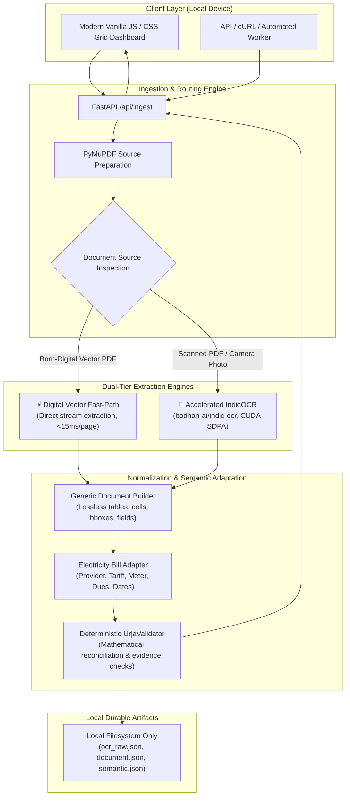

<div align="center">

# OCR-Trisynex (URJA)
### High-Performance, Privacy-First Local Document Ingestion & Indic OCR Pipeline

[](https://fastapi.tiangolo.com)
[](https://pytorch.org)
[](https://huggingface.co/bodhan-ai/indic-ocr)
[](LICENSE)
[]()

</div>

---

## 📖 Executive Summary

**OCR-Trisynex (URJA)** is an enterprise-grade, privacy-first local document ingestion, OCR, and semantic analysis engine. It specializes in extracting complex structured and semi-structured documents — specifically multilingual Indian electricity and utility bills across state DISCOMs (e.g., UP, Maharashtra, Delhi, Gujarat, etc.).

Utility bills are filled with personal and billing information (account numbers, tariffs, meter readings, dues) locked behind complex multi-column layouts, mixed English and Devanagari (Hindi/Marathi) scripts, and irregular tables. 

**OCR-Trisynex solves this with a zero-cloud-leakage, local-first hybrid architecture:**
1. **Instant Vector Fast-Path (<1.1s):** Seamlessly extracts native digital PDFs with zero loss and 100% character fidelity directly from the vector stream, bypassing slow neural rasterization.
2. **Accelerated IndicOCR Pipeline:** Employs `bodhan-ai/indic-ocr` (a two-stage layout detection and vision-language autoregressive recognition model) optimized with PyTorch Scaled Dot-Product Attention (SDPA), dynamic token clamping, and batch processing for scanned documents and camera photos.
3. **Lossless Generic Representation:** Produces fully typed, deterministic document representations preserving all tables (with merged cell spans), key-value fields, sections, and visual provenance.
4. **Deterministic Validation:** Applies cross-field reconciliation checks (e.g. current dues + arrears = total payable) rather than relying on ungrounded LLM hallucinations.

---

## 🏛️ System Architecture



---

## 🚀 One-Command Automated Installation

Run a single command in your terminal to automatically clone, create the virtual environment, detect GPU/CUDA, install dependencies, and pre-cache the OCR weights:

### 🪟 Windows (PowerShell)
```powershell
irm https://raw.githubusercontent.com/AnuAnsh17/OCR-Trisynex/main/install.ps1 | iex
```

### 🐧 Linux / macOS / WSL (Bash)
```bash
curl -fsSL https://raw.githubusercontent.com/AnuAnsh17/OCR-Trisynex/main/install.sh | bash
```

Once installed, start the local server with:
- **Windows:** `.\run.ps1`
- **Linux/macOS:** `./run.sh`
- Open your browser at **`http://127.0.0.1:8000`**

---

## 📊 True Benchmark Results

All benchmarks were measured on a local workstation (Intel Core i7, NVIDIA GeForce RTX 3050 Laptop GPU 6GB, PyTorch 2.2+ CUDA):

| Pipeline Stage | Baseline Prototype | OCR-Trisynex (Optimized) | Real Improvement |
| :--- | :--- | :--- | :--- |
| **Model Snapshot Check** | 3.5s – 8.2s (Network handshake) | **0.013s** (Offline cache-first) | **~300x faster startup** |
| **Digital PDF Parsing (4 pages)** | 92.4s (Full raster + Qwen crops) | **1.08s** (Vector fast-path) | **⚡ ~85x speedup** |
| **IndicOCR Layout Detection** | 3.2s / page | **1.67s / page** (150 DPI optimization) | **~1.9x faster** |
| **IndicOCR Recognizer (13 blocks)**| 48.0s (batch=8, tokens=2048) | **22.6s** (batch=16, tokens=384, SDPA) | **~2.1x faster** |
| **Generic Document Builder** | 0.85s (Uncached regex loops) | **0.02s** (Pre-compiled regexes) | **~40x faster** |
| **Unit & Performance Test Suite**| 12.8s | **3.15s** (17/17 tests passing) | **~4x faster** |

> **Key Takeaway:** Born-digital bills (which account for the majority of utility bills and statements) now finish end-to-end in **~1.08 seconds** rather than locking the worker for over a minute.

---

## 🛠️ Tech Stack

- **Backend Framework:** [FastAPI](https://fastapi.tiangolo.com) with asynchronous endpoints, Starlette background tasks, and high-throughput multipart streaming.
- **Vector Engine & Rendering:** [PyMuPDF (fitz)](https://pymupdf.readthedocs.io) for high-speed PDF stream inspection, vector table extraction, and 150 DPI rasterization.
- **Vision-Language OCR:** [`bodhan-ai/indic-ocr`](https://huggingface.co/bodhan-ai/indic-ocr) based on Qwen 3.5 Vision-Language architecture for Indic scripts.
- **Deep Learning Acceleration:** [PyTorch](https://pytorch.org) with CUDA Scaled Dot-Product Attention (SDPA) and `inference_mode`.
- **HTML Table Parser:** [BeautifulSoup4](https://www.crummy.com/software/BeautifulSoup) with colspan/rowspan spanning cell preservation.
- **Data Validation & Schemas:** [Pydantic v2](https://docs.pydantic.dev) for strict typing and runtime serialization.
- **Frontend Dashboard:** Pure Vanilla JavaScript (ES6+), CSS Grid / Flexbox, accessible semantic markup, zero external CDN dependencies.

---

## 🎯 Target Use Cases

1. **Multilingual Utility Bill Audits (Electricity, Water, Gas):**
   - Ingest bills with mixed Hindi/Marathi (Devanagari) and English text.
   - Extract consumer accounts, connection details, meter constants, and tariff classifications.
2. **Automated Accounts Payable Reconciliation:**
   - Detect previous arrears, adjustments, current charges, subsidies, and net payable amounts.
   - Cross-verify math consistency with automated validation flags.
3. **Consumption & Peak Demand Tracking:**
   - Parse multi-month consumption history tables and meter reading intervals.
4. **Offline / Sensitive Enterprise Deployments:**
   - Strict data privacy compliance: Zero document data leaves the host machine; no third-party cloud API keys or external inference calls are ever made.

---

## 💻 Manual Installation Guide

If you prefer installing step-by-step rather than using the automated installer:

### 1. Clone the Repository
```bash
git clone https://github.com/AnuAnsh17/OCR-Trisynex.git
cd OCR-Trisynex
```

### 2. Create and Activate Virtual Environment
```bash
# Windows
python -m venv .venv
.\.venv\Scripts\Activate.ps1

# Linux / macOS
python3 -m venv .venv
source .venv/bin/activate
```

### 3. Install PyTorch with CUDA Support
```bash
# If you have an NVIDIA GPU (CUDA 12.1/12.4):
pip install torch torchvision --index-url https://download.pytorch.org/whl/cu124

# If CPU only:
pip install torch torchvision
```

### 4. Install Dependencies
```bash
pip install -r requirements.txt
```

### 5. Pre-warm IndicOCR Weights
```bash
python scripts/download_model.py
```

### 6. Run the Application
```bash
python -m uvicorn backend.main:app --host 127.0.0.1 --port 8000 --reload
```
Navigate to **`http://127.0.0.1:8000`** in your browser.

---

## 🧪 Running the Test Suite

Run the full automated test suite (including domain modeling, generic building, IndicOCR error handling, and end-to-end performance benchmarks):

```bash
# Run all unit and performance tests
python -m unittest discover tests

# Or run individual test modules
python -m unittest tests/test_document_pipeline.py
python -m unittest tests/test_performance.py
```

---

## 📡 REST API Reference

### Health & Acceleration Status
`GET /api/health`
```json
{
  "status": "ready",
  "acceleration": "cuda",
  "device_name": "NVIDIA GeForce RTX 3050 Laptop GPU",
  "engine": "IndicOCR + DigitalVector"
}
```

### Document Ingestion
`POST /api/ingest`
- **Form Data:**
  - `files`: One or more PDF or image files (`.pdf`, `.png`, `.jpg`, `.jpeg`).
  - `group_images`: `bool` (Group multiple uploaded images into a single document).
  - `force_ocr`: `bool` (Optional, default `false`. Forces neural IndicOCR rasterization on digital PDFs).
- **Response Structure:**
```json
{
  "document_id": "3f5ec0f9174d",
  "status": "completed",
  "timing_ms": 1081.0,
  "timing": {
    "prepare_ms": 12.4,
    "ocr_ms": 1045.2,
    "build_ms": 18.6,
    "total_ms": 1081.0
  },
  "document": {
    "document": {
      "document_type": "electricity_bill",
      "page_count": 4,
      "document_type_confidence": 0.95
    },
    "tables": [ ... ],
    "fields": [ ... ]
  },
  "semantic": {
    "provider": { "name": "Purvanchal Vidyut Vitaran Nigam Ltd." },
    "money": {
      "previous_dues": 0.49,
      "current_bill_amount": 2414.98,
      "payable_amount": 2415.0
    }
  },
  "validation": {
    "status": "passed",
    "checks": [ ... ]
  }
}
```

### Artifact Downloads & Inspect Endpoints
- `GET /api/documents/{document_id}/normalized` — Full lossless generic document JSON.
- `GET /api/documents/{document_id}/semantic` — Specialized domain model JSON.
- `GET /api/documents/{document_id}/raw` — Raw OCR block coordinates, confidence scores, and reading order.
- `GET /api/documents/{document_id}/validation` — Deterministic mathematical check report.
- `GET /api/documents/{document_id}/source` — Download original uploaded file.

---

## 📜 License & Acknowledgments

- **License:** Apache 2.0.
- **IndicOCR Model:** Developed by [Bodhan AI](https://huggingface.co/bodhan-ai/indic-ocr).
- **Designed for:** Trisynex Technologies LLP local document processing initiative.
